# Player X (prototype)

Launcher de bureau qui regroupe tes jeux **Steam, Epic Games et EA**, compte ton **temps de jeu**, te prévient quand **tes amis se connectent** (Steam, PlayStation, serveur Discord) et suit ta **progression Battlefield 6**.

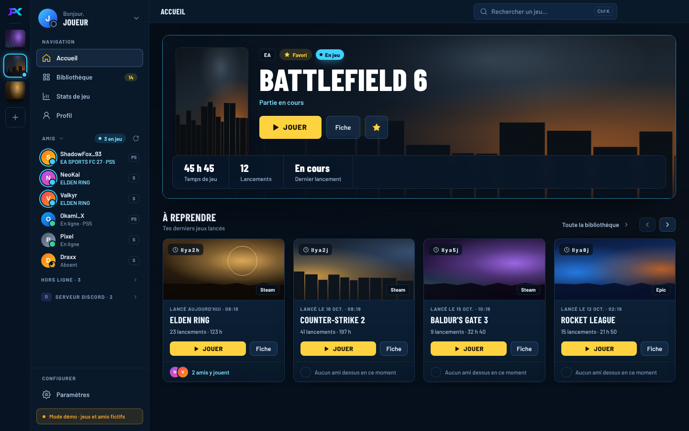

> Les captures sont faites en mode démo : jeux, amis et joueurs fictifs, visuels de remplacement.

## Installer

- **Le plus simple :** télécharge `Player-X-Installer-<version>.exe` depuis les [Releases](https://github.com/Moon-ItachiDEV/player-x/releases/latest). Une seule fenêtre aux couleurs de l’appli : dossier, raccourci du Bureau, démarrage avec Windows, puis **Installer** (ou **Mettre à jour** si Player X est déjà là). L’installeur n’est pas signé, donc Windows SmartScreen peut afficher « Windows a protégé votre ordinateur » : clique sur **Informations complémentaires** puis **Exécuter quand même**.
- **Installeur classique :** `Player-X-Setup-<version>.exe`, l’assistant Windows habituel. C’est aussi lui que les mises à jour automatiques installent ; l’installeur sur mesure le lance en silencieux et s’en sert de repli si WebView2 manque.
- **Depuis le code** (Node.js 22+ sous Windows ; le scan de jeux vise Windows, macOS et Linux ne détectent que Steam) :

```bash
npm install
npm run dev
```

Sur l’écran d’accueil, **Essayer le mode démo** remplit l’interface avec des jeux et des amis fictifs, sans aucune configuration.

Pour fabriquer l’installeur Windows : `npm run dist` (sortie dans `dist/`). Depuis Linux, il faut `wine64` et `wine32:i386`. L’installeur sur mesure (Go + WebView2, dossier `installer/`) se construit ensuite avec Go 1.22+ : `node scripts/build-installer.mjs dist/Player-X-Setup-<version>.exe dist/win-unpacked <version> dist/Player-X-Installer-<version>.exe`.

## Bibliothèque

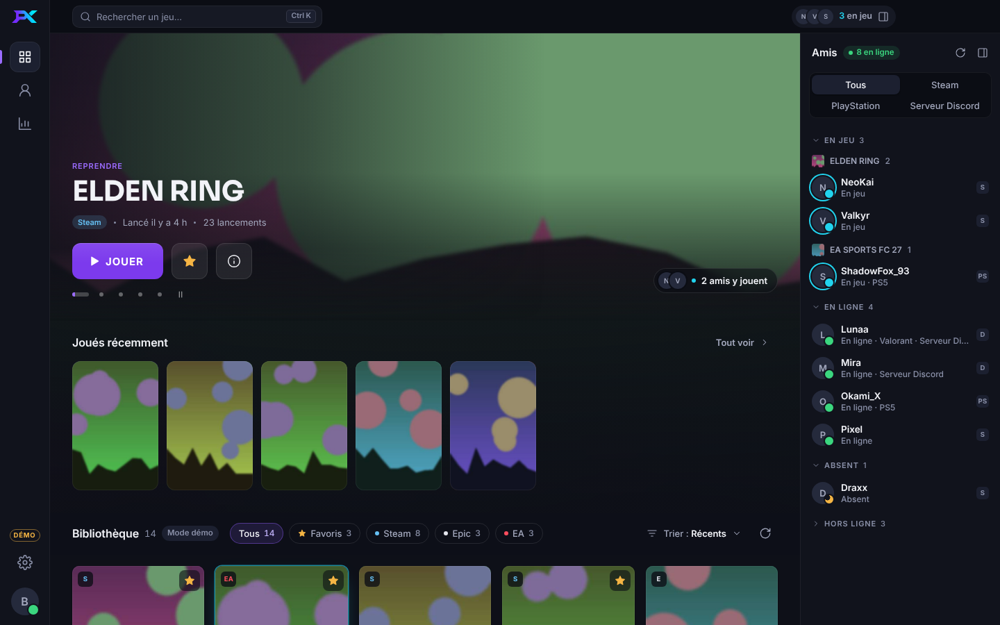

Player X détecte les jeux installés sur ton PC (Steam, Epic Games, EA app). Filtre par store, trie par récents, nom, plus lancés ou plus joués, et choisis la taille des jaquettes. Tes favoris restent dans le rail de gauche, sur toutes les pages : un clic lance le jeu, un clic droit ouvre sa fiche.

L’onglet **Non installés** montre les jeux de ton compte Steam qui ne sont pas sur ce PC, avec ton temps de jeu. **Installer** ouvre l’installation dans Steam (choix du disque, téléchargement) ; une fois le jeu téléchargé, il rejoint ta bibliothèque tout seul. Il faut ta clé Steam Web API et des détails de jeu publics sur ton profil Steam : **Paramètres › Bibliothèque** indique ce qui manque.

## Actus des jeux

La fiche d’un jeu montre ses dernières annonces officielles publiées sur Steam, notes de patch comprises, et les ouvre en entier dans Player X. Un jeu mis à jour ces 7 derniers jours porte un badge **Nouveau patch** jusqu’à ce que tu ouvres ses actus. Les jeux EA et Epic vendus aussi sur Steam (Battlefield 6…) ont leurs actus. Se coupe dans **Paramètres › Bibliothèque**.

## Temps de jeu

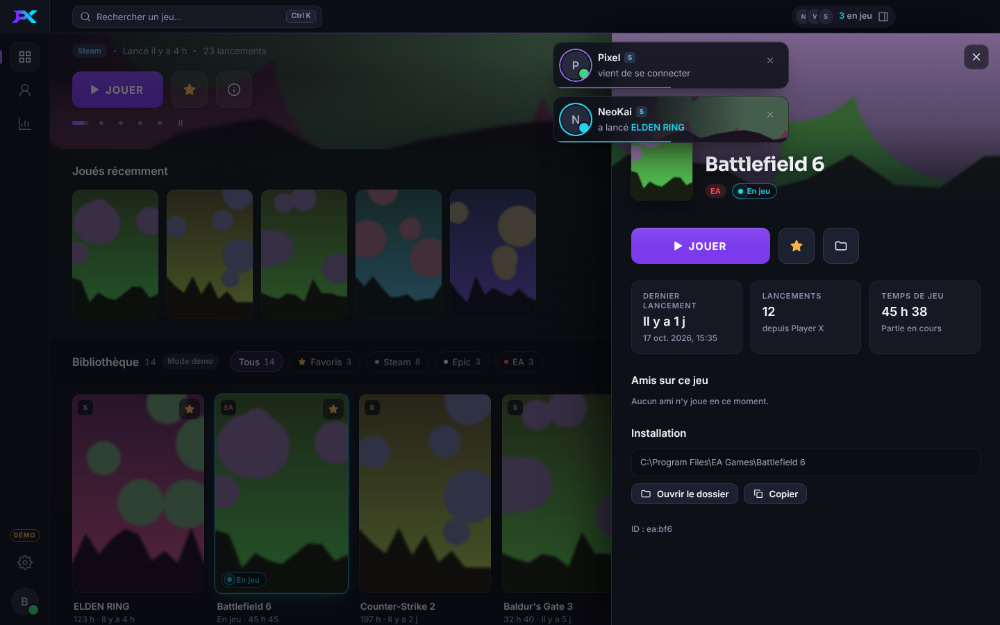

Toutes les minutes, Player X regarde quels programmes tournent et les rattache au dossier d'installation de tes jeux : le temps compte aussi pour un jeu lancé hors du launcher, tant que Player X est ouvert (même réduit). Pour les jeux Steam, Player X reprend le compteur de Steam (tout ton historique) dès que ta clé Steam Web API est renseignée et que les détails de jeu de ton profil sont publics. Le jeu qui tourne porte une pastille cyan **En jeu**, et la bibliothèque se trie par **Plus joués**.

## Près de l’horloge

La croix range Player X dans la zone de notification au lieu de le fermer : le temps de jeu, les alertes d’amis et le bilan Battlefield 6 continuent. Un clic sur l’icône le rouvre ; son menu montre les jeux en cours et **Quitter Player X**. Une mise à jour ou l’arrêt de Windows le ferment toujours. **Démarrer avec Windows** le lance caché à l’ouverture de ta session (version installée seulement). Les deux se règlent dans **Paramètres › Interface** (**Fermer la fenêtre** : Ranger ou Quitter).

## Alertes d'amis

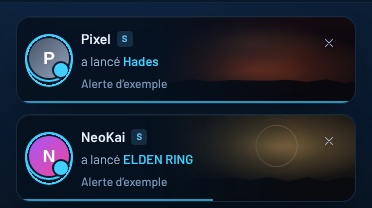

Quand un ami Steam ou PlayStation se connecte ou lance un jeu, une carte apparaît en haut à droite de Player X. Si la fenêtre est en arrière-plan, c'est une notification Windows (Windows les met de côté pendant un jeu en plein écran). Les membres d'un serveur Discord ne déclenchent pas d'alerte : ce ne sont pas des amis. Règle-les dans **Paramètres › Interface** : tout, seulement les jeux lancés, ou aucune, avec un bouton **Tester**.

## Stats de jeu : Battlefield 6

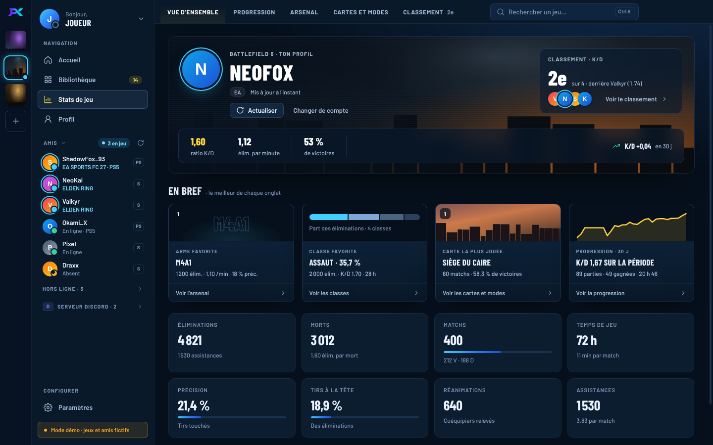

Cherche ton pseudo EA, Steam, PlayStation ou Xbox. La **Vue d’ensemble** montre ratio K/D, kills par minute, victoires, précision, temps de jeu et tes temps forts : arme, classe et carte préférées, évolution de ton K/D sur 30 jours. Les onglets **Arsenal** et **Cartes et modes** détaillent chaque arme, véhicule, classe, mode et carte. Ajoute des **rivaux** pour comparer vos stats dans l’onglet **Classement**.

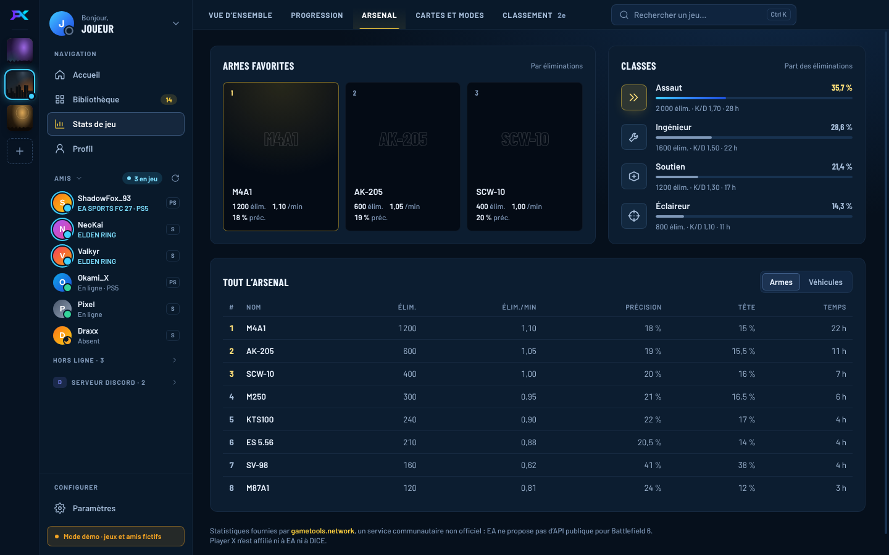

**Progression** (onglet du même nom) : Player X garde un relevé de tes stats par jour (à chaque visite de la page, et en arrière-plan si le dernier date de plus de 20 heures) et trace ta courbe de K/D, d'éliminations par minute ou de victoires, sur 7 jours, 30 jours ou depuis le début, avec tes éliminations, tes parties et ton temps de jeu sur la période. Les relevés restent sur ton PC.

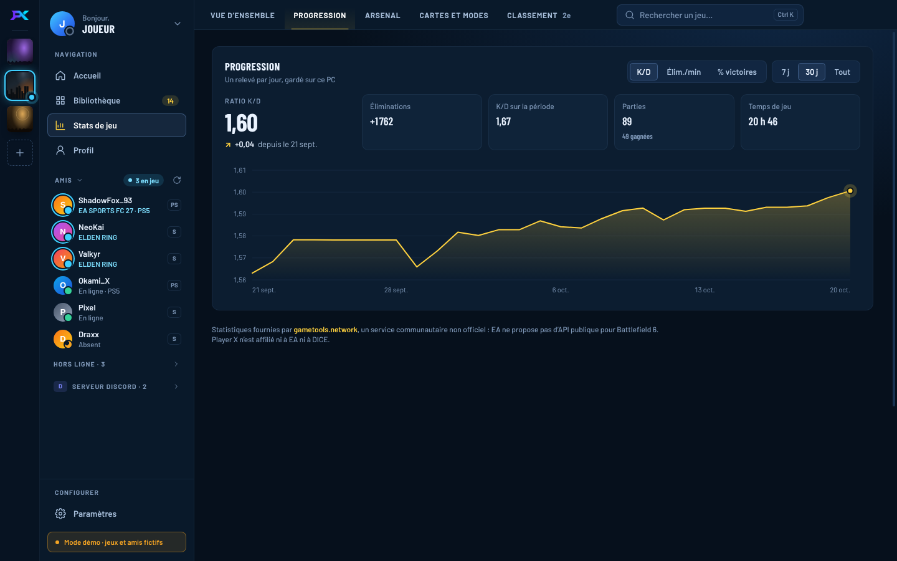

**Bilan de session** : quand tu quittes Battlefield 6, une carte résume ta session : K/D comparé à ta moyenne, éliminations, morts, victoires, éliminations par minute, assistances, réanimations, ton arme et ta classe de la session, les cartes jouées. Player X relève tes stats au lancement du jeu et les relit après la partie : gametools.network met parfois plusieurs minutes à compter les dernières parties, alors le bilan arrive quelques minutes après la fermeture du jeu et se complète si une partie est comptée en retard. Si Player X est caché, une notification Windows te prévient. Tes dernières sessions restent dans la **Vue d’ensemble**, sous **Dernière session**. Il faut ton profil relié et Player X ouvert pendant la partie (même réduit ou près de l’horloge). Se coupe dans **Paramètres › Interface**.

EA ne propose pas d’API publique pour Battlefield 6. Les chiffres viennent de [gametools.network](https://gametools.network), un service communautaire non officiel, sans clé : il peut être lent ou indisponible, et la recherche est limitée à environ une requête toutes les 30 secondes. Les stats sont gardées en cache 10 minutes, et la dernière lecture reste affichée hors ligne. Les visuels du jeu viennent de la page Steam de Battlefield 6.

## Counter-Strike 2 : match en direct et bilan

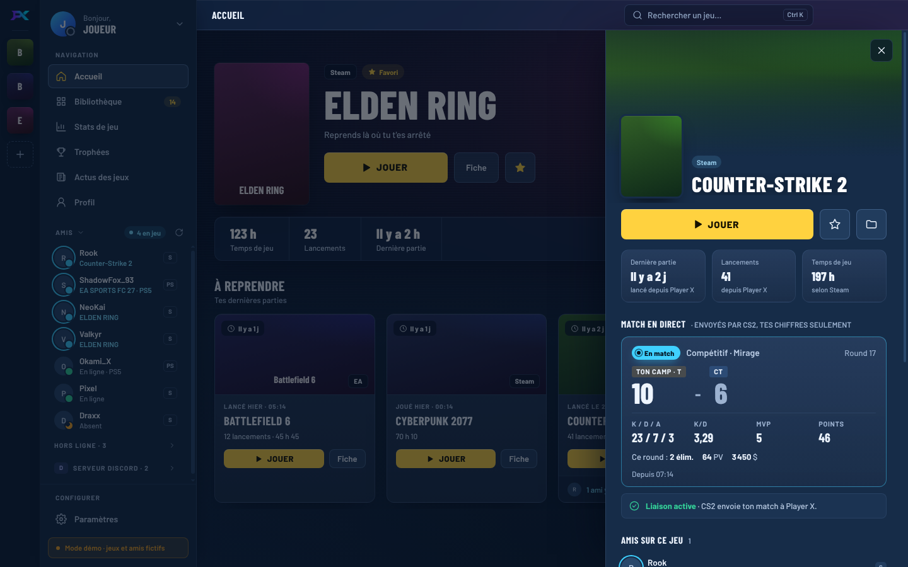

Pendant un match, la fiche de CS2 montre une carte **En match** : carte et mode, round en cours, score de ton camp, tes éliminations, morts et assistances, ton K/D, tes MVP, tes points, et dans le round en cours tes éliminations, tes points de vie et ton argent. À la fin du match, un **bilan** s’ouvre (ou une notification Windows si Player X est caché, une seule à la fermeture du jeu) : résultat et score, K/D, % de headshots, dégâts par round (ADR), MVP, meilleur round, rounds à 3K, 4K ou ace, et la **frise des rounds** (gagnés, perdus, et comment : élimination, bombe, désamorçage, temps écoulé). Tes derniers matchs restent dans la fiche de CS2.

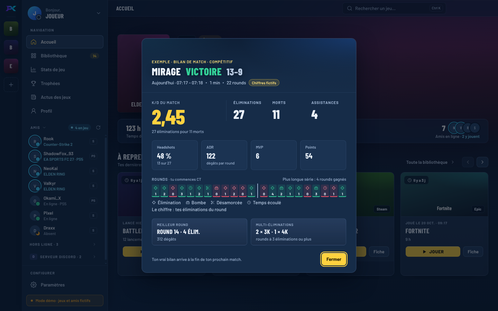

Les chiffres viennent de CS2 lui-même, par la [Game State Integration](https://developer.valvesoftware.com/wiki/Counter-Strike:_Global_Offensive_Game_State_Integration) de Valve : officielle, gratuite, sans clé ni compte, et sans risque pour l’anti-triche. Player X dépose un petit fichier `gamestate_integration_playerx.cfg` dans le dossier `game/csgo/cfg` de CS2 ; le jeu le lit à son démarrage (relance-le s’il tournait déjà) et envoie ensuite l’état du match à Player X, sur ton PC seulement (`127.0.0.1`, avec un jeton). En partie, CS2 ne donne que tes chiffres, pas ceux des autres joueurs ; mort, il envoie le joueur que tu regardes, que Player X ignore. Un match rejoint en cours de route a un bilan partiel (headshots et ADR sur les rounds suivis). Se coupe dans **Paramètres › Interface** (le fichier est alors retiré).

### Overlay CS2 (bêta)

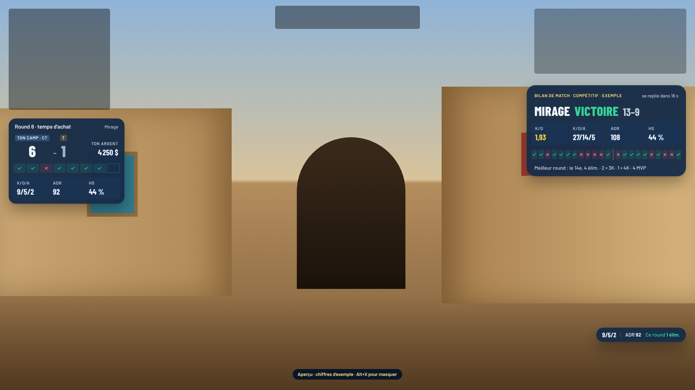

*Montage sur un décor factice : le temps d'achat, la pastille et le bilan ne s'affichent pas en même temps.*

Depuis la 0.9.2, **Paramètres › Overlay** a un bloc par jeu : Counter-Strike 2 (gratuit), puis Fortnite (Premium, en préparation : la popup **Gratuit ou Premium** compare les formules, rien à acheter). L'overlay CS2 pose les mêmes chiffres par-dessus le jeu, dans trois styles : **Verre** (par défaut), **Apple** et **Player X**. **Aperçu à l'écran** les montre 24 s avec des chiffres d'exemple. En match, l'overlay suit tout seul : carte du temps d'achat (score, argent, frise des rounds, K/D/A, ADR, HS), pastille pendant le round, carte de mi-temps, puis bilan 20 s à la fin. C'est une fenêtre transparente de Player X : rien n'est injecté dans CS2, elle ne prend ni la souris ni le clavier. Elle ne se voit qu'avec CS2 en **plein écran fenêtré** (Windows ne montre rien devant un jeu en plein écran exclusif). **Alt+X** la masque ou la réaffiche. En jeu, le style B est un verre teinté sans flou : une fenêtre ne peut pas flouter le jeu derrière elle.

## Profil

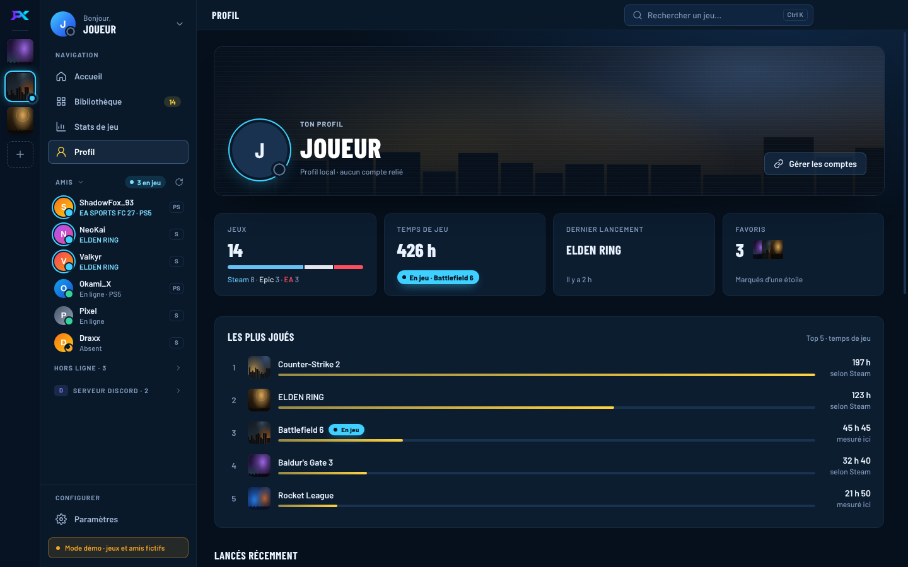

Ton temps de jeu total, tes jeux les plus joués, tes jeux par plateforme et tes derniers lancements depuis Player X.

## Mises à jour

Player X vérifie les [GitHub Releases](https://github.com/Moon-ItachiDEV/player-x/releases) au démarrage puis toutes les 6 heures. Seule la version installée se met à jour, pas `npm run dev`.

1. **Téléchargement** en arrière-plan, avec la progression de 0 à 100 % dans une carte en bas de l’écran.

   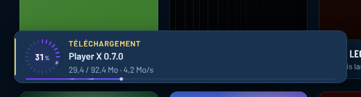

2. **Redémarrage automatique** au bout de 10 secondes. **Plus tard** annule : la mise à jour s’installe alors à la fermeture de Player X. Le compte à rebours ne tourne que si la fenêtre de Player X est au premier plan, pour ne jamais te couper en pleine partie.

   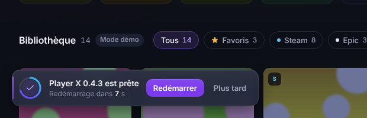

3. **Quoi de neuf** s’ouvre au premier lancement de la nouvelle version, avec les notes de `docs/release-notes/<version>.md`.

   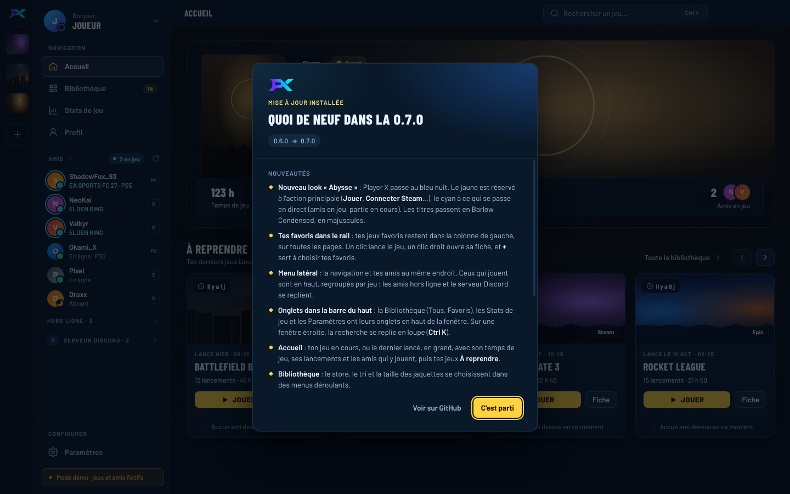

**Mises à jour signées** (depuis la 0.5.1) : chaque installeur publié est signé avec une clé privée qui n’est jamais sur GitHub. Avant de proposer une mise à jour, Player X télécharge sa signature (`Player-X-Setup-<version>.exe.sig`) et la vérifie avec la clé publique livrée dans l’appli (`src/shared/update-key.json`). Une version non signée ou modifiée est refusée et n’est jamais installée, même si quelqu’un publie une release à la place du propriétaire du dépôt.

**Les versions 0.3.0 et plus anciennes n’ont pas de mise à jour automatique** : installe une version 0.4 à la main une fois, les suivantes arriveront toutes seules. L’animation et le redémarrage automatique arrivent avec la 0.4.2 : ils s’affichent pour les mises à jour faites depuis cette version.

Pour publier une version :

1. Monte la version : `npm version 0.5.0 --no-git-tag-version` (met à jour `package.json` et `package-lock.json`).
2. Écris les notes dans `docs/release-notes/<version>.md` : elles servent à la fois pour la release GitHub et pour la fenêtre « Quoi de neuf ».
3. Commit et pousse sur `main`.
4. Lance l’action [`release.yml`](.github/workflows/release.yml) depuis l’onglet **Actions › Release › Run workflow** (elle crée le tag `v<version>`), ou pousse le tag toi-même : `git tag v0.5.0 && git push --tags`. Elle construit l’installeur sous Windows et prépare une release **en brouillon** avec `Player-X-Setup-<version>.exe`, son `.blockmap` et `latest.yml` (le fichier que lit l’appli). Un tag poussé à la main doit correspondre à `version`, sinon l’action s’arrête. Le résumé de l’action affiche l’empreinte SHA-512 à signer.
5. Signe l’installeur **hors de GitHub**, avec la clé privée : `node scripts/update-signature.mjs sign <version> <sha512> <clé-privée.pem>`. Le script refuse une clé qui ne correspond pas à la clé publique de l’appli.
6. Lance l’action [`publish.yml`](.github/workflows/publish.yml) (**Actions › Publish › Run workflow**) avec cette signature. Elle retélécharge l’installeur du brouillon, vérifie la signature, ajoute `Player-X-Setup-<version>.exe.sig` et publie la release. Une signature fausse arrête tout avant la publication.

**Version de test (canal Bêta)** : même chemin, avec un numéro de préversion (`npm version 0.8.1-beta.1 --no-git-tag-version`). Les deux actions la publient en **préversion** GitHub, jamais « Latest » : seuls ceux qui ont choisi **Paramètres › À propos › Canal › Bêta** la reçoivent (la signature est vérifiée pareil). Le canal Stable lit `/releases/latest`, qui ne renvoie jamais une préversion. Repasser en Stable ne revient pas en arrière : on reste sur la bêta jusqu'à la version stable suivante (`0.8.1` passe devant `0.8.1-beta.3`). Le canal n'existe qu'à partir de la 0.8.0 : elle doit sortir en stable avant la première bêta.

Si la clé privée est perdue, les versions installées ne peuvent plus se mettre à jour toutes seules : il faut réinstaller Player X à la main. Garde-en une copie de sauvegarde.

## Ce qui marche

| Fonction | Comment |
|---|---|
| Jeux Steam | Lit `libraryfolders.vdf` et les `appmanifest_*.acf` de toutes tes bibliothèques (registre + disques C à H). |
| Jeux Epic | Lit les manifestes `C:\ProgramData\Epic\EpicGamesLauncher\Data\Manifests\*.item`. |
| Jeux EA | Dossier d’installation de l’EA app, registre `EA Games` / `Electronic Arts`, entrées de désinstallation et `__Installer\installerdata.xml`. |
| Jeux Steam non installés | `IPlayerService/GetOwnedGames` (clé Steam Web API, détails de jeu publics), relu au plus toutes les heures. **Installer** passe par `steam://install/<appid>` ; la fin du téléchargement est lue dans le manifeste du jeu. |
| Actus des jeux | `ISteamNews/GetNewsForApp`, public et sans clé, annonces officielles seulement. Titres relevés au plus toutes les 6 h pour les badges, texte complet à l’ouverture de la fiche, lu en éléments React (jamais de HTML venu d’internet). |
| Jaquettes | Steam : CDN Steam. EA et Epic : recherche du même jeu dans le catalogue Steam, mise en cache 7 jours. Sinon, une jaquette générée. |
| Lancer un jeu | Passe par le client officiel (`steam://`, `com.epicgames.launcher://`, `origin2://`), sinon lance l’exécutable trouvé. |
| Login Steam | OpenID Steam dans ton navigateur, signature vérifiée auprès de Steam. |
| Login Discord | OAuth2 (`identify`) dans ton navigateur, une fois l’application développeur renseignée. |
| Amis Steam | Steam Web API (clé gratuite, liste d’amis publique requise). |
| Amis PlayStation | Non officiel, via [`psn-api`](https://github.com/achievements-app/psn-api) et ton jeton NPSSO. Peut casser sans prévenir. |
| Discord | Discord ne donne pas la liste d’amis aux applis tierces. On affiche à la place les membres en ligne d’un serveur dont le **widget** est activé. |
| Temps de jeu | Processus en cours rattachés au dossier d’installation (Windows, PowerShell `Get-Process`), compteur Steam via `IPlayerService/GetOwnedGames`. |
| Alertes d’amis | Différence entre deux lectures de la liste d’amis ; carte dans l’appli ou notification Windows. |
| Près de l’horloge | `Tray` d’Electron ; la croix cache la fenêtre (réglage **Fermer la fenêtre**). Démarrage avec Windows : `app.setLoginItemSettings` avec `--hidden`, état relu (Windows peut l’avoir désactivé dans le Gestionnaire des tâches). |
| Stats Battlefield 6 | Non officiel, via [gametools.network](https://gametools.network). Recherche multi-plateforme, rivaux suivis, cache local, relevé quotidien pour la progression. |
| Bilan Battlefield 6 | Différence entre la lecture gametools au lancement du jeu (vu par le suivi du temps de jeu) et les relectures après la partie (2, 5, 10, 15, 30, 60 et 120 min), jusqu’à deux lectures identiques 15 min après la fin. La session est gardée en base : elle reprend si Player X redémarre pendant la partie. |
| Match CS2 | Game State Integration de Valve : fichier `gamestate_integration_playerx.cfg` (sans BOM) dans `game/csgo/cfg`, envois du jeu reçus sur `127.0.0.1:47730` (ou un des 9 ports suivants) avec un jeton, toutes les 0,5 s au plus et toutes les 10 s sans changement. Rounds découpés par la phase du round, match clos à la fin, au retour au menu ou après 35 s sans envoi. Le match en cours est gardé en base : il reprend si Player X redémarre pendant la partie. |
| Profil | Temps de jeu total, jeux les plus joués (ou les plus lancés sans temps de jeu), jeux par plateforme et derniers lancements. |
| Mises à jour | `electron-updater` et GitHub Releases : progression, redémarrage après 10 s, fenêtre « Quoi de neuf ». Canal Bêta : `allowPrerelease`, préversions GitHub, jamais de retour en arrière. |
| Favoris, historique | Stockés en local. |

## Configuration

Tout se règle dans **Paramètres** de l’appli (ou, en développement seulement, dans un fichier `.env`, voir `.env.example`). Les clés et jetons restent dans le processus principal, chiffrés par Windows : l’interface n’en voit que les 4 derniers caractères, et on peut les remplacer ou les effacer.

- **Clé Steam Web API** : https://steamcommunity.com/dev/apikey
- **Discord** : crée une appli sur https://discord.com/developers/applications, copie Client ID et Client Secret, et ajoute la redirection `http://127.0.0.1:47823/discord/callback` dans OAuth2.
- **Serveur Discord** : dans les paramètres du serveur, active « Activer le widget du serveur » et enregistre, puis copie l’« Identifiant du serveur » affiché en dessous (le lien « JSON API » marche aussi).
- **PlayStation** : connecte-toi sur playstation.com puis ouvre https://ca.account.sony.com/api/v1/ssocookie et copie la valeur `npsso`.
- **Battlefield 6** : rien à configurer, cherche ton pseudo dans **Stats de jeu**.
- **Counter-Strike 2** : rien à configurer. Player X relie CS2 tout seul ; relance le jeu s’il tournait au moment de la mise à jour.

## Design

Direction « Braise » depuis la 0.9.0 : fond prune très sombre, rose (#ff5c86) pour l’action et le focus, cyan réservé à « en jeu », or réservé aux succès. Un seul rail à gauche (pages, favoris, Paramètres) et une barre du haut avec la recherche globale (**Ctrl K** : jeux, amis, membres du serveur, pages). Titres en Sora, interface en Inter. Les effets riches (survol, lueurs, animations) se coupent dans **Paramètres** et respectent « réduire les animations » du système. Les couleurs sont dans `src/renderer/src/styles/tokens.css` ; les anciennes directions (« Arène · Abysse », « Nuit Néon ») restent dans [`docs/design/`](docs/design/).

## Choix techniques

- **Electron + React + Vite + TypeScript** plutôt que Next.js : un launcher doit lire le disque et lancer des programmes, ce qu’une appli web ne peut pas faire.
- **Base de données** : SQLite locale via `sql.js` (WebAssembly, rien à compiler sous Windows), dans le dossier de données de l’appli. Pas de serveur pour l’instant : il deviendra utile pour des comptes partagés entre appareils ou des fonctions sociales.
- **Secrets** (clés, jetons, comptes) chiffrés avec `safeStorage` (DPAPI sous Windows).
- **Réseau** : toutes les requêtes externes (Steam, PSN, Discord, gametools) passent par le processus principal, l’interface n’appelle jamais internet directement.
- **Styles** : CSS simple avec des variables (`styles/tokens.css`), sans bibliothèque d’interface. Polices embarquées, aucune requête vers Google Fonts.

```
src/
  main/          processus Electron : base SQLite, scan des jeux, logins, amis, stats
    services/    games.ts, steamLibrary.ts, artwork.ts, news.ts, auth.ts, friends.ts, alerts.ts, playtime.ts, stats.ts, bf6Recap.ts,
                 bf6Diff.ts, cs2Live.ts, cs2Match.ts, cs2Gsi.ts, tray.ts, settings.ts, demo.ts, updater.ts
  preload/       pont sécurisé main ↔ interface
  renderer/src/
    components/  home/, library/, friends/, stats/, cs2/, settings/, setup/, ui/, FavRail (rail des favoris), Sidebar (menu et amis),
                 TopBar et TopTabs (barre du haut à onglets), GameSheet, Profile, Login,
                 UpdateNotice (carte de mise à jour), WhatsNew (fenêtre « Quoi de neuf »), FriendAlerts (alertes d’amis)
    update/      animation de mise à jour « Séquence Réacteur »
    styles/      tokens.css, base.css, shell.css, transitions.css
  shared/        types et fonctions de texte communs
docs/
  release-notes/ notes de chaque version (release GitHub + « Quoi de neuf »)
  screenshots/   captures du README
  design/        spec et recherches de design
resources/       icône de l’appli et logos PX
```
