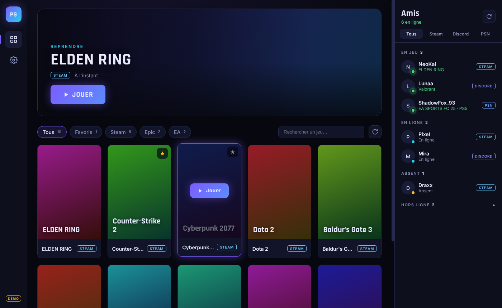

# Player X (prototype)

Launcher de bureau qui regroupe tes jeux **Steam, Epic Games et EA** et montre **quels amis sont en ligne** (Steam, PlayStation, serveur Discord).



## Installer

- **Le plus simple :** lance `Player-X-Setup-<version>.exe` et suis l’assistant. L’installeur n’est pas signé, donc Windows SmartScreen peut afficher « Windows a protégé votre ordinateur » : clique sur **Informations complémentaires** puis **Exécuter quand même**.
- **Depuis le code** (Node.js 22+ sous Windows ; le scan de jeux vise Windows, macOS et Linux ne détectent que Steam) :

```bash
npm install
npm run dev
```

Sur l’écran d’accueil, **Essayer le mode démo** remplit l’interface avec des jeux et des amis fictifs, sans aucune configuration.

Pour fabriquer l’installeur Windows : `npm run dist` (sortie dans `dist/`). Depuis Linux, il faut `wine64` et `wine32:i386`.

## Ce qui marche

| Fonction | Comment |
|---|---|
| Jeux Steam | Lit `libraryfolders.vdf` et les `appmanifest_*.acf` de toutes tes bibliothèques (registre + disques C à H). |
| Jeux Epic | Lit les manifestes `C:\ProgramData\Epic\EpicGamesLauncher\Data\Manifests\*.item`. |
| Jeux EA | Dossier d’installation de l’EA app, registre `EA Games` / `Electronic Arts`, entrées de désinstallation et `__Installer\installerdata.xml`. |
| Jaquettes | Steam : CDN Steam. EA et Epic : recherche du même jeu dans le catalogue Steam, mise en cache 7 jours. Sinon, une jaquette générée. |
| Lancer un jeu | Passe par le client officiel (`steam://`, `com.epicgames.launcher://`, `origin2://`), sinon lance l’exécutable trouvé. |
| Login Steam | OpenID Steam dans ton navigateur, signature vérifiée auprès de Steam. |
| Login Discord | OAuth2 (`identify`) dans ton navigateur, une fois l’application développeur renseignée. |
| Amis Steam | Steam Web API (clé gratuite, liste d’amis publique requise). |
| Amis PlayStation | Non officiel, via [`psn-api`](https://github.com/achievements-app/psn-api) et ton jeton NPSSO. Peut casser sans prévenir. |
| Discord | Discord ne donne pas la liste d’amis aux applis tierces. On affiche à la place les membres en ligne d’un serveur dont le **widget** est activé. |
| Profil | Jeux par plateforme, jeux les plus lancés et derniers lancements depuis Player X. |
| Favoris, historique | Stockés en local. |

## Configuration

Tout se règle dans **Paramètres** de l’appli (ou dans un fichier `.env`, voir `.env.example`) :

- **Clé Steam Web API** : https://steamcommunity.com/dev/apikey
- **Discord** : crée une appli sur https://discord.com/developers/applications, copie Client ID et Client Secret, et ajoute la redirection `http://127.0.0.1:47823/discord/callback` dans OAuth2.
- **Serveur Discord** : ID du serveur (clic droit > Copier l’identifiant, en mode développeur) avec le widget activé.
- **PlayStation** : connecte-toi sur playstation.com puis ouvre https://ca.account.sony.com/api/v1/ssocookie et copie la valeur `npsso`.

## Design

Direction « Nuit Néon » : fond graphite, violet comme seule couleur de marque, cyan réservé à « en jeu ». Titres en Sora, interface en Inter, logo PX et nom en Michroma. Inspirée de Blitz.gg, GOG Galaxy, Steam, Discord et de concepts Dribbble. La spec complète, la critique et les recherches sont dans [`docs/design/`](docs/design/).

## Choix techniques

- **Electron + React + Vite + TypeScript** plutôt que Next.js : un launcher doit lire le disque et lancer des programmes, ce qu’une appli web ne peut pas faire.
- **Base de données** : SQLite locale via `sql.js` (WebAssembly, rien à compiler sous Windows), dans le dossier de données de l’appli. Pas de serveur pour l’instant : il deviendra utile pour des comptes partagés entre appareils ou des fonctions sociales.
- **Secrets** (clés, jetons, comptes) chiffrés avec `safeStorage` (DPAPI sous Windows).
- **Styles** : CSS simple avec des variables (`styles/tokens.css`), sans bibliothèque d’interface. Polices embarquées, aucune requête vers Google Fonts.

```
src/
  main/          processus Electron : base SQLite, scan des jeux, logins, amis
    services/    games.ts, artwork.ts, auth.ts, friends.ts, settings.ts, demo.ts
  preload/       pont sécurisé main ↔ interface
  renderer/src/
    components/  library/, friends/, settings/, ui/, GameSheet, Profile, Login, Rail, TopBar
    styles/      tokens.css, base.css, shell.css
  shared/        types et fonctions de texte communs
resources/       icône de l’appli et logos PX
```
